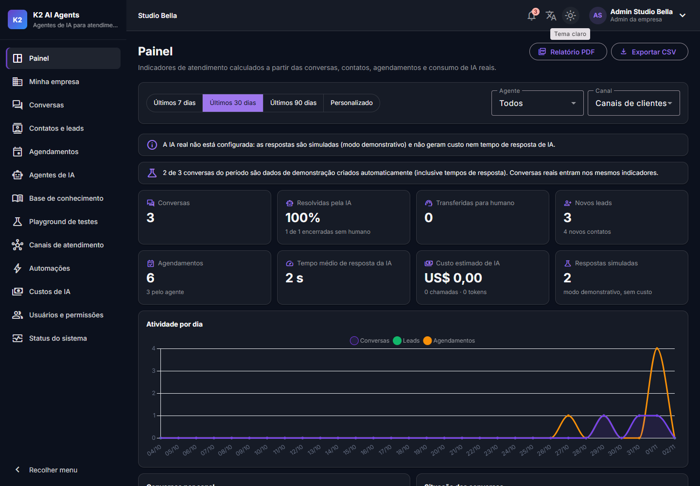
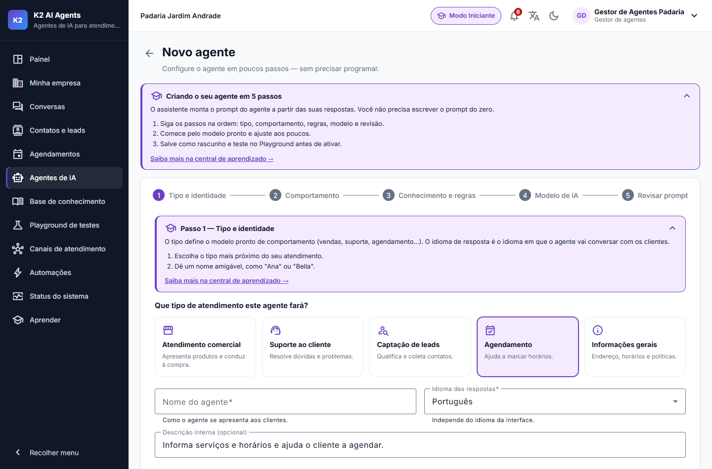
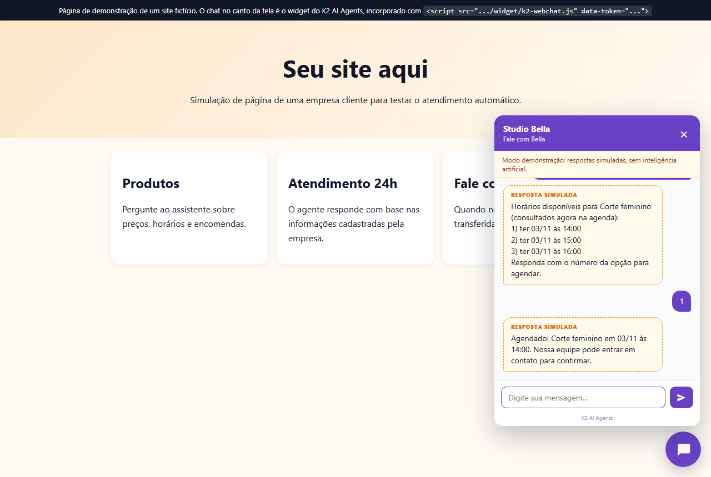
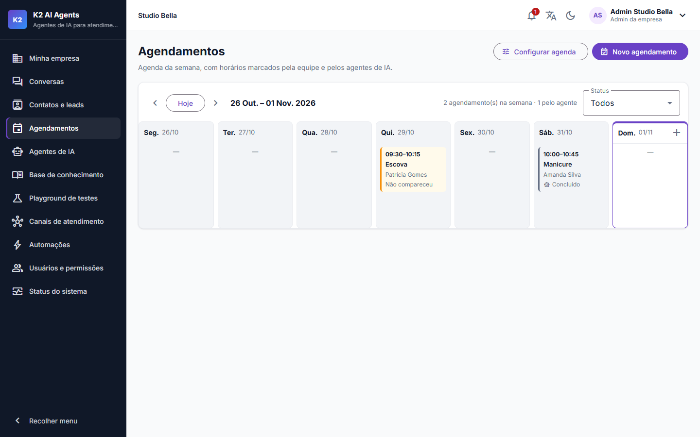
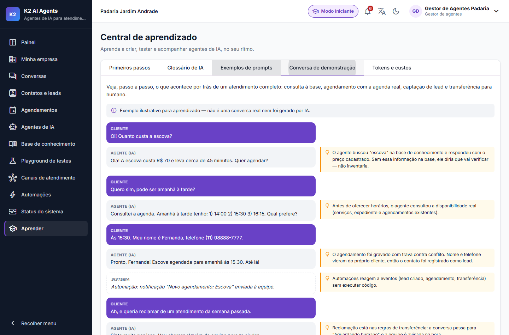
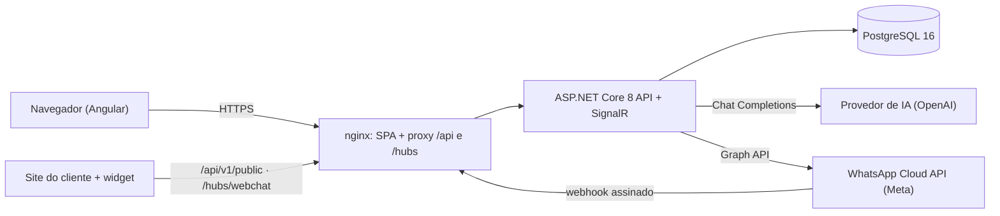

# K2 AI Agents

Plataforma SaaS para empresas criarem, testarem e gerenciarem **agentes de IA de atendimento**: o agente responde clientes no site (Web Chat) e no WhatsApp, consulta a base de conhecimento da empresa, capta leads, agenda serviços consultando a agenda real e transfere para um humano quando necessário. Faz parte do ecossistema **K2 Digital**.



| Assistente de criação do agente | Web Chat agendando com a agenda real |
| --- | --- |
|  |  |
| **Agenda semanal** | **Modo Iniciante — conversa de demonstração anotada** |
|  |  |

---

## Sumário

- [Visão geral](#visão-geral)
- [Arquitetura](#arquitetura)
- [Tecnologias](#tecnologias)
- [Instalação e execução com Docker](#instalação-e-execução-com-docker)
- [Credenciais de demonstração](#credenciais-de-demonstração)
- [Configuração de IA](#configuração-de-ia)
- [Configuração de banco](#configuração-de-banco)
- [Desenvolvimento local (sem Docker)](#desenvolvimento-local-sem-docker)
- [Como criar agentes](#como-criar-agentes)
- [Como testar agentes](#como-testar-agentes)
- [Como utilizar o Web Chat](#como-utilizar-o-web-chat)
- [Como preparar o WhatsApp](#como-preparar-o-whatsapp)
- [Segurança e privacidade (LGPD)](#segurança-e-privacidade-lgpd)
- [Testes](#testes)
- [API](#api)
- [Limitações](#limitações)
- [Roadmap](#roadmap)

---

## Visão geral

| Módulo | O que faz |
| --- | --- |
| **Painel** | Indicadores reais do período (conversas, resolução pela IA, transferências, leads, agendamentos, tempo de resposta, custo estimado), comparação com o período anterior, gráficos, relatório em PDF e exportação CSV. |
| **Empresas** | Multiempresa com isolamento total de dados; cada empresa tem usuários, agentes, canais e retenção próprios. |
| **Agentes de IA** | Assistente de 5 passos (tipo, comportamento, regras e FAQs, modelo, revisão do prompt), modelos prontos por tipo de atendimento, idioma de resposta por agente, versões com restauração. |
| **Base de conhecimento** | Textos, FAQs e upload de PDF/TXT/DOCX; busca *full-text* em português (PostgreSQL, sem acentos); o agente cita as fontes usadas. |
| **Playground** | Conversa de teste com o agente mostrando tokens, latência, custo estimado e fontes consultadas. |
| **Conversas** | Caixa de entrada em tempo real (SignalR), transferência IA → humano, assumir/devolver à IA, painel do contato e histórico. |
| **Contatos e leads** | Funil de etapas; dados de contato captados **somente do que o cliente escreveu**; anonimização (LGPD). |
| **Agendamentos** | Agenda semanal, serviços e expediente com intervalos, regra anticonflito com trava no banco; o agente só confirma depois de consultar a disponibilidade real. |
| **Automações** | Regras "quando X, faça Y" com gatilhos e ações de um conjunto fechado (nenhum código do usuário é executado). |
| **Canais** | Web Chat incorporável (um `<script>`) e WhatsApp pela **API oficial da Meta** (Cloud API). |
| **Custos de IA** | Custo estimado mês a mês pelos tokens reais × tabela de preços, conciliado com o valor da fatura lançado pelo Super Admin. |
| **Usuários e permissões** | Perfis Super Admin, Admin da empresa, Gestor de agentes, Atendente e Consulta. |
| **Modo Iniciante** | Guias por módulo, termos explicados, tutorial com progresso real, glossário de IA, exemplos de prompts, conversa de demonstração e simulador de custos. |

Interface completa em **português e inglês** — inclusive as mensagens de erro da API —, tema claro/escuro e layout responsivo.

## Arquitetura

Monólito modular em **Clean Architecture** no backend e SPA Angular no frontend, servidos por Docker Compose:



```
BackEnd/
  src/
    K2Agents.Domain          entidades e enums (sem dependências)
    K2Agents.Application     casos de uso, validações (FluentValidation), regras de negócio, orquestração da IA
    K2Agents.Infrastructure  EF Core/PostgreSQL, OpenAI, WhatsApp Cloud API, criptografia, PDF, seed, jobs
    K2Agents.Api             controllers REST, SignalR, autenticação JWT, rate limiting, tradução das mensagens
  tests/K2Agents.Tests       xUnit: integração (WebApplicationFactory), PostgreSQL real (Testcontainers), unidade
FrontEnd/k2-agents-web       Angular 20 (standalone, signals), Angular Material, Transloco, Chart.js
  public/widget              widget do Web Chat (JavaScript puro, Shadow DOM)
docker-compose.yml           PostgreSQL + API + Web (nginx)
```

Decisões principais:

- **Isolamento multiempresa** por filtro global do EF Core e validação na escrita: um usuário nunca lê ou grava dados de outra empresa (há testes específicos).
- **Abstração do provedor de IA** (`IAIProvider`): o orquestrador monta o prompt (instruções do agente + trechos da base + regras da plataforma por último), controla histórico, limites diários e custo, e executa *tool calling* para agendamentos.
- **Regras da plataforma não removíveis** no prompt: não inventar dados, tratar documentos e mensagens como dados (proteção contra *prompt injection*), transferir para humano quando necessário.
- **Tempo real** com SignalR (caixa de entrada e widget), com *fallback* para *long polling*.

## Tecnologias

| Camada | Tecnologias |
| --- | --- |
| Backend | .NET 8, ASP.NET Core Web API, EF Core 8 + Npgsql, FluentValidation, JWT, Serilog, Swagger, SignalR, PdfPig |
| Frontend | Angular 20 (standalone + signals), RxJS, Reactive Forms, Angular Material 3, Transloco (pt-BR/en), Chart.js |
| Dados | PostgreSQL 16 (busca *full-text* em português com `unaccent`) |
| IA | OpenAI Chat Completions (via `IAIProvider`, trocável) |
| Canais | Web Chat próprio; WhatsApp Business Platform (Cloud API oficial) |
| Infra | Docker, Docker Compose, nginx, GitHub Actions |
| Testes | xUnit, WebApplicationFactory, Testcontainers (PostgreSQL), Karma/Jasmine |

## Instalação e execução com Docker

Requisitos: **Docker** com Docker Compose.

```bash
# 1. Gere o .env com segredos aleatórios (anote a senha do Super Admin exibida)
sh scripts/setup-env.sh                                   # Linux / macOS / Git Bash
powershell -ExecutionPolicy Bypass -File scripts/setup-env.ps1   # Windows

# 2. (Opcional) informe OPENAI_API_KEY no .env para respostas de IA reais

# 3. Suba tudo
docker compose up -d --build
```

| Serviço | Endereço |
| --- | --- |
| Aplicação | http://localhost:4310 |
| API + Swagger | http://localhost:5100/swagger |
| Health check | http://localhost:5100/health |
| PostgreSQL | localhost:5436 |

Na primeira subida a API aplica as *migrations* e carrega os dados de demonstração (5 empresas, agentes, base de conhecimento, conversas identificadas como demonstração, contatos, agenda e automações). **O seed nunca chama a IA** (nenhum custo).

> Em produção, termine o HTTPS num proxy reverso/balanceador na frente do nginx e restrinja `SWAGGER_ENABLED`.

## Credenciais de demonstração

| Perfil | E-mail | Senha |
| --- | --- | --- |
| Super Admin | `admin@k2digital.com` | a senha gerada pelo script (`SEED_ADMIN_PASSWORD`) |
| Admin de empresa | `admin@padaria.demo` | `Demo@2026` (`SEED_DEMO_PASSWORD`) |
| Gestor de agentes | `gestor@padaria.demo` | `Demo@2026` |
| Atendente | `atendente@padaria.demo` | `Demo@2026` |
| Consulta | `consulta@padaria.demo` | `Demo@2026` |

As demais empresas seguem o padrão `admin@<empresa>.demo` e `atendente@<empresa>.demo`, com `<empresa>` = `studiobella`, `horizonte`, `petvida` ou `energia`. Agentes de demonstração: **Ana** (padaria), **Bella** (salão — agendamentos), **Lucas** (imobiliária), **Nina** (clínica veterinária) e **Max** (academia).

Fora do ambiente de desenvolvimento a API **não cria usuários com senha padrão**: sem `SEED_ADMIN_PASSWORD`/`SEED_DEMO_PASSWORD`, a inicialização é interrompida com uma mensagem explicando o que configurar.

## Configuração de IA

| Variável (`.env`) | Descrição |
| --- | --- |
| `OPENAI_API_KEY` | Chave da OpenAI. Fica só no servidor: nunca vai para o navegador nem para os logs. |
| `OPENAI_DEFAULT_MODEL` | Modelo padrão dos agentes novos (ex.: `gpt-4o-mini`). |

Sem chave, a plataforma funciona no **modo demonstrativo**: Playground e Web Chat respondem com base nas FAQs e na base de conhecimento, sempre identificados como **SIMULADO**, sem custo. No WhatsApp, sem chave, a conversa vai direto para a equipe — um cliente real nunca recebe resposta simulada.

Limites e preços ficam em `BackEnd/src/K2Agents.Api/appsettings.json`: `AI:Limits` (requisições e tokens diários por empresa, tamanho de mensagem) e `AI:Models` (modelos disponíveis e preço por milhão de tokens, usado no custo estimado).

## Configuração de banco

PostgreSQL 16 no container `k2-agents-postgres` (volume persistente). Variáveis: `POSTGRES_DB`, `POSTGRES_USER`, `POSTGRES_PASSWORD`, `POSTGRES_PORT`.

- *Migrations* aplicadas automaticamente na inicialização (`Database:MigrateOnStartup`).
- Seed controlado por `SEED_DEMO_DATA` (`true`/`false`); cada etapa só roda se a tabela estiver vazia.
- Criar uma *migration* nova: `dotnet ef migrations add Nome -p BackEnd/src/K2Agents.Infrastructure -s BackEnd/src/K2Agents.Api -o Persistence/Migrations` (ferramenta em `BackEnd/.config/dotnet-tools.json`: `dotnet tool restore`).

## Desenvolvimento local (sem Docker)

Requisitos: .NET SDK 8 (versão em `global.json`), Node.js 22, Docker apenas para o PostgreSQL.

```bash
docker compose up -d k2-agents-postgres

cd BackEnd/src/K2Agents.Api
dotnet user-secrets set "ConnectionStrings:Default" "Host=localhost;Port=5436;Database=k2agents;Username=k2agents;Password=<POSTGRES_PASSWORD>"
dotnet run --urls http://localhost:5100      # ambiente Development

cd FrontEnd/k2-agents-web
npm ci
npm start                                    # http://localhost:4200 (proxy para a API na porta 5100)
```

Em `Development`, sem `Jwt:Secret` ou `Secrets:EncryptionKey`, a API usa chaves temporárias (com aviso no log) e o seed aceita as senhas de demonstração padrão.

## Como criar agentes

1. **Agentes de IA → Novo agente.**
2. **Tipo e identidade:** escolha o tipo (vendas, suporte, captação de leads, agendamento, informações gerais), o nome e o idioma de resposta.
3. **Comportamento:** objetivo, personalidade e tom — ou aplique o modelo pronto do tipo.
4. **Regras:** perguntas frequentes, restrições ("não prometa descontos") e regras de transferência para humano.
5. **Modelo:** modelo de IA, temperatura e limite de resposta, com estimativa de custo por troca.
6. **Revisão:** o prompt é gerado a partir das respostas; ajuste se quiser e salve. As regras de segurança da plataforma são acrescentadas automaticamente.
7. Adicione conteúdo em **Base de conhecimento**, teste no **Playground** e mude o status para **Ativo**.

Cada alteração cria uma versão; versões anteriores podem ser restauradas. Ative o **Modo Iniciante** (🎓 no topo) para ver o tutorial guiado e exemplos de prompts.

## Como testar agentes

- **Playground:** converse como cliente; veja as fontes da base usadas, tokens, tempo de resposta e custo estimado. Testes no Playground não entram nas métricas de atendimento.
- **Modo demonstrativo:** sem chave de IA (ou ativando a opção), as respostas são simuladas e não têm custo.
- **Agendamento:** com um agente do tipo Agendamento e a agenda da empresa configurada (Agendamentos → Configurar agenda), peça um horário; no Playground a reserva não é gravada.

## Como utilizar o Web Chat

1. **Canais → Novo Web Chat:** escolha o agente, título, cor, posição e mensagens.
2. Informe os **domínios autorizados** (recomendado): o widget só funciona nesses sites.
3. Copie o código de instalação e cole antes de `</body>` no site:

```html
<script src="https://seu-dominio/widget/k2-webchat.js" data-token="wc_..." async></script>
```

4. Use **Testar em site de demonstração** para ver o widget funcionando. As conversas aparecem em tempo real em **Conversas**.

O token do widget apenas identifica o canal; a conversa de cada visitante é protegida por uma chave secreta que só o navegador dele tem (o servidor guarda o *hash*). O widget usa Shadow DOM e nunca interpreta HTML vindo das mensagens.

## Como preparar o WhatsApp

A integração usa exclusivamente a **WhatsApp Business Platform — Cloud API** oficial da Meta (nada de automação do WhatsApp Web).

**Na Meta:**
1. Crie uma conta Meta Business e um app do tipo *Business* em [developers.facebook.com](https://developers.facebook.com).
2. Adicione o produto **WhatsApp** e cadastre/verifique o número.
3. Anote o **Phone Number ID** e o **WhatsApp Business Account ID** (WhatsApp → Configuração da API).
4. Gere um **token permanente** de um *usuário do sistema* com as permissões `whatsapp_business_messaging` e `whatsapp_business_management` (o token temporário expira em 24 h).
5. Anote o **App Secret** (Configurações do app → Básico).

**Na plataforma (perfil Admin da empresa):**
1. **Canais → Conectar WhatsApp:** informe Phone Number ID, access token e App Secret. As credenciais são cifradas (AES-256-GCM) e nunca são exibidas de novo.
2. Clique em **Testar conexão** (consulta o número na Graph API).
3. Copie a **URL de callback** e o **token de verificação** exibidos no cartão do canal e cadastre-os em WhatsApp → Configuração → Webhook, assinando o campo `messages`. A URL precisa ser **HTTPS pública** (em desenvolvimento, use um túnel como ngrok ou Cloudflare Tunnel).
4. **Ative** o canal.

Como funciona: a Meta envia cada mensagem ao webhook; a API confere a assinatura `X-Hub-Signature-256` com o App Secret **antes** de qualquer processamento, responde 200 imediatamente e processa em segundo plano — sem duplicar reenvios (idempotência pelo ID da mensagem). O agente responde pela Cloud API; respostas de atendentes saem pela caixa de entrada e respeitam a **janela de 24 horas** da Meta (fora dela, a plataforma bloqueia o envio e explica o motivo).

## Segurança e privacidade (LGPD)

- **Autenticação:** JWT de curta duração em memória + *refresh token* rotativo em cookie HttpOnly/SameSite=Strict, com detecção de reuso; senhas com PBKDF2; bloqueio após 5 tentativas.
- **Autorização:** RBAC por perfil em todos os endpoints e isolamento multiempresa no banco.
- **Rate limiting:** login (força bruta), renovação de sessão, IA, widget público e limite global.
- **Segredos:** chave da OpenAI e do JWT só em variáveis de ambiente; credenciais de canais cifradas com AES-256-GCM (`SECRETS_ENCRYPTION_KEY`). Nenhum token é registrado em logs. A API não sobe sem as chaves em produção.
- **IA:** regras da plataforma no fim do prompt, documentos tratados como dados (anti-*prompt injection*), detector de vazamento de prompt, dados pessoais captados apenas do texto do cliente, agendamento só após consulta à agenda real, nenhuma ação financeira executada pela IA.
- **Uploads:** tipo, tamanho e número de páginas validados; DOCX com proteção contra *zip bomb* e DTD.
- **Frontend:** CSP restritiva (sem scripts inline), `X-Frame-Options`, `Permissions-Policy`, `Referrer-Policy`.
- **LGPD:** retenção de conversas por empresa (job diário apaga conversas além do prazo, exceto as em atendimento humano, com registro na auditoria), anonimização de contatos (inclusive o número do WhatsApp guardado na conversa), exportações com dados pessoais restritas a gestores e auditadas, trilha de auditoria das ações sensíveis.

## Testes

```bash
dotnet test BackEnd/K2Agents.sln                   # 250 testes (requer Docker para os testes com PostgreSQL)
cd FrontEnd/k2-agents-web && npx ng test --watch=false --browsers=ChromeHeadless   # 12 testes
```

Cobertura por área: autenticação e sessão, autorização e isolamento entre empresas, CRUD e versões de agentes, extração e busca na base de conhecimento (inclusive *full-text* no PostgreSQL real), Playground, persistência de conversas, Web Chat e SignalR, transferência para humano, contatos e LGPD, agendamentos sem conflito (inclusive 8 reservas simultâneas no PostgreSQL), automações, limites de uso, erros do provedor de IA, relatórios e custos, tradução das mensagens (com teste que falha se surgir mensagem sem tradução), WhatsApp (assinatura, idempotência, janela de 24 h), criptografia, retenção e exigências de produção. Os provedores de IA e do WhatsApp são **simulados** nos testes: nenhuma chamada paga ou externa.

O **CI** (GitHub Actions) compila com avisos tratados como erro, roda todos os testes, audita pacotes NuGet e npm e constrói as imagens Docker.

## API

REST versionada em `/api/v1` com documentação Swagger (`/swagger`): `auth`, `companies`, `users`, `agents`, `knowledge`, `playground`, `conversations`, `messages`, `contacts`, `appointments`, `automations`, `channels`, `notifications`, `dashboard`, `reports`, além dos endpoints públicos do widget (`/api/v1/public/webchat`) e do webhook do WhatsApp (`/api/v1/webhooks/whatsapp`). Erros seguem o padrão *ProblemDetails*, no idioma do cabeçalho `Accept-Language` (pt-BR ou en).

## Limitações

- **IA real:** a integração com a OpenAI (incluindo *tool calling* para agendamentos) é coberta por testes com provedor simulado; o comportamento com uma chave real depende da conta e do modelo configurados.
- **WhatsApp:** testado com o cliente simulado e com chamadas reais à Graph API apenas para o caso de credencial inválida. Uma conexão completa exige conta Meta Business, número verificado e URL HTTPS pública. Somente mensagens de texto são respondidas (mídias recebem um aviso), e mensagens fora da janela de 24 horas (modelos aprovados) não são suportadas.
- **Fila do WhatsApp em memória:** mensagens já confirmadas à Meta e ainda não processadas se perdem se a API reiniciar nesse intervalo; para alto volume, troque por uma fila persistente.
- **Uma instância da API:** SignalR, fila do WhatsApp e rate limiting são em memória; várias instâncias exigem *backplane* (ex.: Redis) e fila externa.
- **Arquivos** da base de conhecimento ficam em disco local do container (volume); em nuvem, use armazenamento de objetos.
- **Custo faturado** é lançado manualmente a partir da fatura do provedor (a OpenAI não informa o valor cobrado por chamada).
- Conteúdo já salvo (notificações antigas, conversas de demonstração, textos de automações) permanece no idioma em que foi criado.

## Roadmap

- Modelos de mensagem do WhatsApp (fora da janela de 24 h) e mídias (imagem, áudio com transcrição).
- Outros provedores de IA (Anthropic, Azure OpenAI, modelos locais) usando a mesma abstração.
- Busca semântica com *embeddings* (pgvector) combinada à busca *full-text*.
- Instagram Direct e Messenger pela API oficial da Meta.
- Escala horizontal: Redis para SignalR e rate limiting, fila persistente e armazenamento de objetos.
- Planos, cobrança e limites por assinatura; SSO/OAuth.
- Integração com Google Calendar e lembretes automáticos de agendamento.
